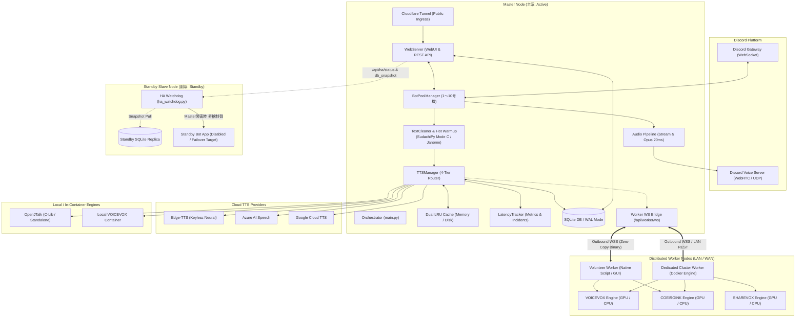

# Discord TTS Bot 動作仕様詳細説明書 (MANUAL)

本書は、分散型音声合成システム「Distributed-TTS-Bot」のシステム設計、コンポーネント動作仕様、ネットワーク通信プロトコル、データベース設計、および運用・保守手順に関する技術仕様書です。

---

## 1. システム概要と基本設計思想

本システムは、Discord の音声通話（Voice Channel）環境において、テキストメッセージを低遅延で合成・再生することを目的とした分散型 Text-to-Speech（TTS）システムです。

### 1.1 設計原則
1. **低遅延音声ストリーミング (Low-Latency Streaming)**
   - 句読点や終助詞、口語境界に基づくテキスト分割（スマートチャンキング）、先行並列推論、および 20ms PCM フレーム単位でのストリーミング供給により、文章全体の生成完了を待たずに音声再生を開始します。
2. **多層フェイルオーバー耐性 (Multi-Tier Resilience)**
   - 音声合成エンジンを外部クラウド、分散コンピュートノード、およびローカルエンジンに階層化し、上位プロバイダのタイムアウトやレート制限、ネットワーク障害時に透過的に下位プロバイダへフォールバックします。
3. **分散コンピュート構成とNAT越え通信**
   - 推論負荷の高いニューラル音声合成（VOICEVOX / COEIROINK / SHAREVOX 等）を外部のGPU搭載ノードへオフロード可能です。
   - ルーター配下や動的IP環境にあるノードからMasterへ外向き接続する WebSocket リバーストンネルを採用し、ルーターのポート開放を不要としています。
4. **動的Botプール管理 (Dynamic Bot Scaling)**
   - Discord APIの接続仕様（1 Botクライアントにつき全サーバー通じて同時1VC接続）に対応するため、最大10台のBotアカウントを動的にプール管理し、複数VCへの同時参加・負荷分散を実現します。
5. **高可用性 (HA) 冗長構成**
   - Master-Slave Active-Standby 構成を標準でサポートし、死活監視デーモン（HA Watchdog）による自動フェイルオーバーと、SQLiteオンラインバックアップによる継続的なデータ同期を提供します。

---

## 2. システムアーキテクチャ

システム全体の構成およびデータフローは以下の通りです。



---

## 3. コアコンポーネント詳細仕様

### 3.1 BotPoolManager (動的Botプール管理)
Discord APIの制約（1クライアントは同時に単一VCのみ接続可能）に対応するため、最大10台のBotクライアントを一元管理します。

- **インフライト接続予約 (In-Flight Reservation)**:
  - 複数ギルドからの同時参加要求による競合を防止するため、`reserve_vc_connection` による原子的ロックを確保し、同一VCへの重複接続を遮断します。
- **号機探索アルゴリズム**:
  1. 対象ギルドに参加していること。
  2. 現在いずれのVCにも接続しておらず、インフライト予約も入っていないこと（`is_bot_busy == False`）。
  3. 若番号機（1号機優先）から順に割り当て。
- **手動切断制御**:
  - `/leave` コマンドまたは切断ボタンにより退出したVCは内部フラグに記録され、全メンバーが退室してチャンネルが空になるまで、自動再参加（Auto-Join）を抑制します。
- **動的スケール (Hot Reload)**:
  - WebUIまたはDB経由でトークンが追加された場合、プロセスを再起動することなく対象号機のインスタンスを生成してGatewayへ接続します（`start_bot(idx, token)`）。

### 3.2 テキスト前処理 & 形態素解析ホットウォーム (`TextCleaner`)
音声合成前のテキスト正規化および文分割を行うコンポーネントです。

- **形態素解析エンジンのホットウォーム機構**:
  - 高精度形態素解析器（SudachiPy Mode C）および Janome に対し、プロセス起動時にサンプル文を用いたウォームアップ処理（`warmup_morphological_tokenizers()`）を実行。辞書インデックスのメモリ展開および探索木の事前構築を行うことで、初回発話時のコールドスタート遅延を解消しています。
- **多段スマートチャンキング (30文字ハードキャップ)**:
  - 句読点（`、` `。` `！` `？`）だけでなく、口語文のスペース区切り、ネットスラング（`w`, `草`, `パチパチ`）、終助詞境界（`〜ですね` `〜ます`）を識別して自然に分割。
  - 句読点のない長文であっても最大30文字以内で安全に分割し、先頭チャンクの先行推論を即座に開始します。
- **音声パイプラインストリーミング**:
  - 合成されたWAVデータ（16bit Mono PCM、48kHz/24kHz）をDiscord標準の 20ms フレーム（960サンプル）へ逐次変換して供給。
  - チャンク境界には自然な発話を促す無音PCM（100〜150ms）を自動挿入し、音切れやノイズの混入を防止します。

### 3.3 動的 4段階 Tier ルーティング (`TTSNodePool`)
接続されている各推論ノードのハードウェア構成（GPUの有無、常駐メモリ、ストレージ種別）を識別し、レイテンシと負荷のバランスに応じた最適なノードへタスクを割り当てます。

| Tier | 名称 | 特徴・用途 |
| :--- | :--- | :--- |
| **Tier 1** | **GPU + RAMDisk** | GPU高速推論とメモリ常駐モデルによる最速応答（最優先） |
| **Tier 2** | **CPU + RAMDisk** | メモリ常駐モデルによる高速推論。GPU負荷を温存しつつ迅速に応答 |
| **Tier 3** | **GPU + SSD** | 大容量モデルや多様な話者をカバーするGPU推論 |
| **Tier 4** | **CPU + SSD** | 汎用CPUとディスクモデルによる安定フォールバック |

- **エンジン別優先順位のリアルタイム制御**:
  - WebUI（「Bot & ノード管理」）から、エンジンごと（COEIROINK, VOICEVOX, SHAREVOX, 共通デフォルト）に Tier の優先順序を動的にカスタマイズ可能です。
- **話者モデル自動判定 (Smart Model Pinpoint Routing)**:
  - リモートノードが保有しているモデル情報（MYCOEIROINK等のUUIDを含む）を自動検出し、該当モデルが存在するノードへ優先してリクエストを振り分けます。

### 3.4 音声合成階層 & 投機的並行フォールバック
指定された話者のプロバイダに応じて、以下の優先順位と保護機構のもとで合成が実行されます。

| プロバイダ | 種別 | 認証 | フェイルオーバー条件 |
| :--- | :--- | :--- | :--- |
| **Edge-TTS** | クラウド (オープン) | 不要 | ネットワークタイムアウト (8秒)、HTTPエラー |
| **Azure Speech** | クラウド (高速) | APIキー + リージョン | キー未設定、401/403/429、タイムアウト (5秒) |
| **Google Cloud** | クラウド (高品質) | サービスアカウントJSON / APIキー | 認証不備、月間無料枠 (95万字) 超過ガード、429 |
| **VOICEVOX** | ローカル / 分散Worker | 共有トークン (Worker) | ノード未応答、VRAM枯渇、タイムアウト |
| **SHAREVOX** | ローカル / 分散Worker | 共有トークン (Worker) | ノード未応答、タイムアウト |
| **COEIROINK** | ローカル / 分散Worker | 共有トークン (Worker) | ノード未応答、タイムアウト |
| **OpenJTalk** | スタンドアロン (C言語) | 不要 | 外部通信を行わないローカルセーフティネット |

- **投機的デュアルストリーミング (Speculative Dual-Streaming)**:
  - ローカル推論ノードへの要求発行後、設定秒数（デフォルト: 1.5秒）以内に先頭チャンクの応答が得られない場合、バックグラウンドで即座にクラウドエンジン（Edge-TTS/Azure）への投機的並行リクエストを発行し、待機時間を短縮します。

### 3.5 モデレーション & 辞書システム
- **NGワードフィルタ (モデレーション)**:
  - ギルドごとに登録された不適切語・暴言をミリ秒単位で検知し、安全な伏字（`＊＊＊`）へ自動置換します。
  - 最長一致スキャンアルゴリズムとインメモリキャッシュにより、部分一致の誤爆を防止しつつ遅延ゼロで処理します。
  - スラッシュコマンド（`/ng add`, `/ng remove`, `/ng list`, `/ng import_default`）および WebUI の双方から管理可能です。
- **サーバー辞書 & ユーザー辞書**:
  - ギルド共通の読み替え辞書（`/dict`）およびユーザー個人の専用辞書（`/userdict`）をサポート。

### 3.6 高可用性 (HA) 冗長化仕様
主系（Master）と副系（Slave）による Active-Standby 冗長化機構を備えています。

- **HA Watchdog (`ha_watchdog.py`)**:
  - 副系ノード上で常駐デーモンとして動作し、Docker Engine API（`/var/run/docker.sock`）を直接制御します。
  - Master の `/api/ha/status` を定期的に監視（デフォルト: 5秒間隔）。
- **オンラインデータベース同期**:
  - Master の `/api/ha/db_snapshot` から定期的に最新データベース（SQLite）を取得。SQLite オンラインバックアップ API を経由することで、トランザクション整合性を保った状態でレプリカを生成します。
- **自動フェイルオーバー & 昇格**:
  - Master の連続無応答を検知（デフォルト: 6回連続）した場合、Slave は自律的に `ttsbot-app` コンテナを起動して主系に昇格します。
- **Split-Brain 防護機構**:
  - 旧 Master が復帰した場合、Slave は即座に自律降格（Preempt Demote）します。
  - システムアップデート時には `data/.ha_updating` シグナルを発行し、一時的な停止に伴う副系の誤昇格を確実に防止します。

### 3.7 レイテンシ監視 & インシデント解析 (`LatencyTracker`)
すべての発話において、発言検知から音声再生開始までの各工程（文分割、推論、ストリーミング供給）のミリ秒単位プロファイリングを実施します。

- **メトリクス指標**:
  - **TTFS (Time-To-First-Sound / Turn-TTFS)**: 発言受領から最初の20msフレームがVCへ送出されるまでの所要時間。
  - **RTF (Real-Time Factor)**: 合成所要時間 / 音声尺。
  - **Under-run (バッファアンダーラン)**: 再生中の音声フレーム枯渇回数。
- **インシデント自動分類**:
  - パフォーマンス低下が検知された場合、原因を自動タグ付けしてDBへ記録：
    - `TEXT_SPLIT_OVERHEAD`: 形態素解析・文章分割処理の遅延。
    - `WORKER_SLOW_CHUNK`: リモートWorkerノードの推論遅延。
    - `CLOUD_API_LATENCY_CHUNK`: 外部クラウドAPIのネットワーク・応答遅延。
    - `SHORT_TEXT_RTF_SPIKE`: 極短文特有の計算比率スパイク。
    - `VOICE_PIPELINE_STALL`: VC再接続や先行ストリーム待ち合わせによる待機。

---

## 4. 分散コンピュート & ボランティア Worker ネットワーク

コミュニティメンバーや外部拠点の余剰GPU/CPUリソースを安全に結集し、推論処理を分散する仕組みです。

### 4.1 通信仕様
- **ポート開放不要のアウトバウンド接続 (Outbound WSS)**:
  - 各WorkerからMasterの `/api/worker/ws` エンドポイントへ向けて外向きに WebSocket（WSS）接続を確立します。ルーターのポート開放や固定IPアドレスは不要です。
- **ゼロコピー・バイナリストリーミングプロトコル**:
  - 音声データの送受信には固定長ヘッダーを持つ独自バイナリフレームを採用しています：
    `[32-byte req_id][4-byte chunk_idx][1-byte flags][raw audio binary]`
  - JSONパースやBase64デコードのオーバーヘッドを完全に排除し、高速なデータ転送を実現しています。

### 4.2 Worker クライアントの実装形態
1. **Windows ネイティブ GUI ランチャー (`run_volunteer_gui.ps1`)**:
   - 初心者向けのGUI画面を備え、接続設定・エンジン検出・稼働ログを一元表示。
2. **バッチ / シェルスクリプト (`run_volunteer.bat` / `run_volunteer.sh`)**:
   - ダブルクリックまたは引数指定で即座にバックグラウンド起動。
3. **専用常時稼働クラスタ (Docker 版 / `setup-worker.ps1` / `setup-worker.sh`)**:
   - Dockerコンテナとして各エンジン（VOICEVOX, COEIROINK, SHAREVOX）とWorkerエージェントを自動起動。

---

## 5. データベース設計 (SQLite3 / WAL Mode)

データベースは `/app/data/bot.db` に保管され、`PRAGMA journal_mode=WAL;` および `PRAGMA synchronous=NORMAL;` により高頻度な並行アクセスに対応します。

### 5.1 主要テーブルスキーマ

#### `bot_tokens` (動的Botプール管理)
```sql
CREATE TABLE IF NOT EXISTS bot_tokens (
    bot_index INTEGER PRIMARY KEY,
    token TEXT NOT NULL,
    label TEXT DEFAULT '',
    is_enabled INTEGER DEFAULT 1,
    created_at TIMESTAMP DEFAULT CURRENT_TIMESTAMP,
    updated_at TIMESTAMP DEFAULT CURRENT_TIMESTAMP
);
```

#### `system_credentials` (認証情報・設定キーバリューストア)
```sql
CREATE TABLE IF NOT EXISTS system_credentials (
    key TEXT PRIMARY KEY,
    value TEXT NOT NULL,
    updated_at TIMESTAMP DEFAULT CURRENT_TIMESTAMP
);
```

#### `guild_settings` (ギルド共通設定)
```sql
CREATE TABLE IF NOT EXISTS guild_settings (
    guild_id INTEGER PRIMARY KEY,
    command_prefix TEXT DEFAULT '!',
    max_text_length INTEGER DEFAULT 50,
    dedup_window_seconds REAL DEFAULT 5.0,
    dedup_max_length INTEGER DEFAULT 10,
    auto_join_vc_id INTEGER DEFAULT 0,
    auto_join_text_channel_id INTEGER DEFAULT 0,
    admin_role_id INTEGER DEFAULT 0,
    default_speaker TEXT DEFAULT 'nanami',
    read_username INTEGER DEFAULT 0,
    announce_vc_events INTEGER DEFAULT 0,
    speculative_timeout_seconds REAL DEFAULT 1.5,
    ignore_prefixes TEXT DEFAULT '[";", "；"]',
    volume REAL DEFAULT 1.0,
    disaster_volume REAL DEFAULT 1.0,
    enable_disaster_alert INTEGER DEFAULT 0,
    disaster_alert_channel_id INTEGER DEFAULT 0,
    disaster_jma_regions TEXT DEFAULT '',
    updated_at TIMESTAMP DEFAULT CURRENT_TIMESTAMP
);
```

#### `user_settings` / `guild_user_settings` (ユーザー個別・ギルド別設定)
```sql
CREATE TABLE IF NOT EXISTS user_settings (
    user_id INTEGER PRIMARY KEY,
    speaker_id TEXT NOT NULL,
    pitch TEXT NOT NULL DEFAULT '0%',
    speed REAL NOT NULL DEFAULT 1.0,
    volume REAL NOT NULL DEFAULT 0.8,
    strip_name_brackets INTEGER NOT NULL DEFAULT 1,
    updated_at TIMESTAMP DEFAULT CURRENT_TIMESTAMP
);

CREATE TABLE IF NOT EXISTS guild_user_settings (
    guild_id INTEGER NOT NULL,
    user_id INTEGER NOT NULL,
    speaker_id TEXT NOT NULL,
    pitch TEXT NOT NULL DEFAULT '0%',
    speed REAL NOT NULL DEFAULT 1.0,
    volume REAL NOT NULL DEFAULT 0.8,
    strip_name_brackets INTEGER NOT NULL DEFAULT 1,
    updated_at TIMESTAMP DEFAULT CURRENT_TIMESTAMP,
    PRIMARY KEY (guild_id, user_id)
);
```

#### `guild_dictionary` / `guild_ng_words` (辞書 & モデレーション)
```sql
CREATE TABLE IF NOT EXISTS guild_dictionary (
    guild_id INTEGER NOT NULL,
    word TEXT NOT NULL,
    reading TEXT NOT NULL,
    created_at TIMESTAMP DEFAULT CURRENT_TIMESTAMP,
    last_used_at TIMESTAMP DEFAULT CURRENT_TIMESTAMP,
    PRIMARY KEY (guild_id, word)
);

CREATE TABLE IF NOT EXISTS guild_ng_words (
    guild_id INTEGER NOT NULL,
    word TEXT NOT NULL,
    created_at TIMESTAMP DEFAULT CURRENT_TIMESTAMP,
    last_used_at TIMESTAMP DEFAULT CURRENT_TIMESTAMP,
    PRIMARY KEY (guild_id, word)
);
```

#### `latency_incidents` (遅延・障害インシデント履歴)
```sql
CREATE TABLE IF NOT EXISTS latency_incidents (
    id INTEGER PRIMARY KEY AUTOINCREMENT,
    created_at TIMESTAMP DEFAULT CURRENT_TIMESTAMP,
    guild_id INTEGER,
    incident_types TEXT,
    root_causes TEXT,
    incident_json TEXT NOT NULL
);
```

---

## 6. WebUI & 内部 API 仕様

### 6.1 認証とセキュリティ
- WebUIへのアクセスはセッションCookieにより保護されます。
- パスワードは PBKDF2-SHA256 で暗号学的ハッシュ化され検証されます。
- 外部公開時は Cloudflare Tunnel 経由での暗号化通信を標準とします。

### 6.2 主要APIエンドポイント一覧

| メソッド | パス | 説明 | 認証 |
| :--- | :--- | :--- | :--- |
| `GET` | `/health` | システム稼働健全性チェック (HTTP 200) | 不要 |
| `GET` | `/api/system/status` | Botプール稼働状態、接続VC、メモリ、キャッシュ統計を取得 | 要セッション |
| `GET` | `/api/system/bots` | 登録済みBotトークン一覧と各号機の接続状態を取得 | 管理者 |
| `POST` | `/api/system/bots` | Botトークンの追加・更新・即時接続起動 | 管理者 |
| `POST` | `/api/system/bots/{idx}/toggle` | 指定号機の有効/無効切替（動的接続/切断） | 管理者 |
| `DELETE` | `/api/system/bots/{idx}` | 指定号機のBotトークン削除および切断 | 管理者 |
| `GET` | `/api/system/credentials` | 登録済みAPIキー・クレデンシャル一覧の取得 | 管理者 |
| `POST` | `/api/system/credentials` | APIキーの保存・即時ホットリロード | 管理者 |
| `GET` | `/api/worker/ws` | リモートWorkerノード用WebSocket接続エンドポイント | Worker Token |
| `GET` | `/setup-worker.ps1` | Windows Worker 自動セットアップスクリプト配信 | 不要 (LAN/WAN適応) |
| `GET` | `/setup-worker.sh` | Linux Worker 自動セットアップスクリプト配信 | 不要 (LAN/WAN適応) |
| `GET` | `/api/ha/status` | 主系HA状態確認用エンドポイント | HA Secret |
| `GET` | `/api/ha/db_snapshot` | 副系同期用 SQLite オンラインバックアップ取得 | HA Secret |

---

## 7. キャッシュ & ログストレージ仕様

### 7.1 キャッシュ分離 (Dual LRU Storage)
- **クラウドキャッシュ (`/app/cache`)**:
  - 最大容量: 10GB（目標値: 8.5GB）
  - Edge-TTS / Azure / Google / OpenJTalk の合成音声を `md5(provider:voice:pitch:speed:text).wav` として保持。
- **VOICEVOX専用キャッシュ (`/app/cache_voicevox`)**:
  - 最大容量: 20GB（目標値: 17GB）
  - 推論コストの高いキャラクター音声データを独立ボリュームで長期保持。

### 7.2 ログローテーション (Two-Stage Hybrid Zstandard Rotation)
- ロギングハンドラ（`TwoStageZstdRotatingHandler`）により、ディスク消費とI/Oを制御。
- アクティブログファイルは最大3,000行に達した時点で直近100行を残して切り詰められ、超過分は `.zst`（Zstandard）形式で圧縮アーカイブされます。
- アーカイブ総容量が上限（1GB）に達した場合は、最古世代から自動パージされます。

---

## 8. 運用・保守・アップデート手順

### 8.1 安全なシステムのアップデート手順 (`update.sh`)
本番通話への影響を最小限に抑えるため、専用のアップデートスクリプトが用意されています。

```bash
# 推奨: スクリプトによるアップデート実行
./update.sh
```

- **事前Pullによる最小瞬断（約2秒）**:
  - 稼働中のコンテナを停止させずにバックグラウンドで最新イメージを事前ダウンロードし、コンテナ切り替え時間を約2秒に短縮します。
- **HA誤昇格の防止 (Split-Brain Guard)**:
  - 更新開始時に `data/.ha_updating` シグナルを発行し、Standbyノードが意図しないフェイルオーバーを起こす事故を防止します。
- **ボランティア Worker への自動再起動通知**:
  - Master 本体の更新完了と同時に、接続中の全 Worker へ WebSocket 経由で更新通知を送信し、自動で最新環境へ追従させます。
- **データベース自動バックアップ**:
  - アップデート前に `data/` 配下の SQLite データベースを `data_backup/` へ自動退避します。

### 8.2 バックアップとリストア
- **手動バックアップ**:
  ```bash
  # WALチェックポイントを実行して安全にオンラインバックアップ
  sqlite3 data/bot.db ".backup 'data/bot_backup.db'"
  ```

### 8.3 障害対応 (Troubleshooting)
1. **BotがVCに接続しない場合**:
   - WebUIの「Bot管理」画面で各号機のステータスが `Ready` になっているか確認します。
   - Discord Developer Portalで対象Botの `SERVER MEMBERS INTENT` および `MESSAGE CONTENT INTENT` が有効になっているか確認します。
2. **音声の遅延やアンダーランが発生する場合**:
   - WebUIの「インシデント履歴」画面を開き、自動分類された原因タグ（`WORKER_SLOW_CHUNK`, `TEXT_SPLIT_OVERHEAD` 等）を確認します。
   - リモートWorkerのネットワーク往復遅延およびGPU負荷状況を確認します。
