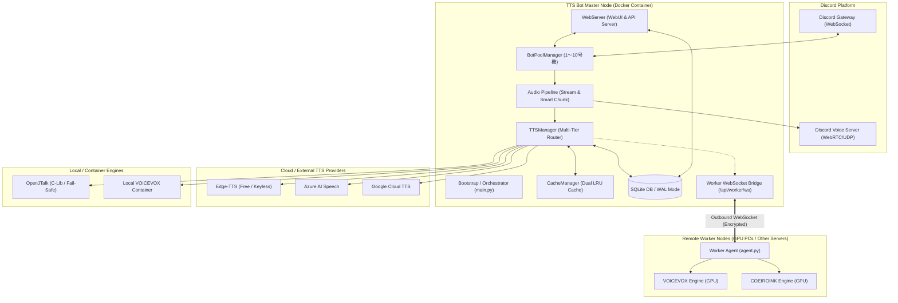

# Discord TTS Bot 動作仕様詳細説明書 (MANUAL)

本書は、本システムの全体構造、コンポーネント動作仕様、ネットワーク通信プロトコル、データベース設計、および運用・保守手順に関する技術仕様書です。

---

## 1. システム概要と基本設計思想

本システムは、Discordの音声通話（Voice Channel）において、テキストメッセージを極めて低い遅延で合成・再生することを主目的とした分散型Text-to-Speech（TTS）システムです。

### 1.1 設計原則
1. **低遅延音声ストリーミング (Ultra-Low Latency Streaming)**
   - 句読点単位のテキスト分割（Smart Chunking）、並列推論、および 20ms PCM フレーム単位でのストリーミング供給により、文章全体の生成完了を待たずに再生を開始します。
2. **多重フェイルオーバー耐性 (Multi-Tier Resilience)**
   - 音声エンジンをクラウド、外部API、ローカルノードに階層化し、上位プロバイダのタイムアウト、レート制限、認証エラー発生時にミリ秒オーダーで下位プロバイダへ自動フォールバックします。
3. **Master-Worker 分散構成とNAT越え通信**
   - 推論負荷の高いニューラル音声合成（VOICEVOX / COEIROINK等）を外部のGPUマシン（Workerノード）へオフロード可能です。
   - ルーター配下や動的IP環境にあるWorkerからMasterへ外向き接続する **WebSocketリバーストンネル** を備え、ルーターのポート開放を不要とします。
4. **動的Botプール管理 (Dynamic Bot Scaling)**
   - Discord APIの「1 Botアカウントにつき全サーバー通じて同時1VC接続」という制限を克服するため、最大10台のBotアカウントを動的にプール管理し、複数VCへの同時参加・負荷分散を実現します。

---

## 2. システムアーキテクチャ



---

## 3. コンポーネント詳細仕様

### 3.1 BotPoolManager (動的Botプール)

Discord APIの仕様上、1つのBotトークン（Client）は全ギルドを通じて同時に1つのボイスチャンネルにしか接続できません。BotPoolManagerは最大10台のBotクライアントを一元管理し、以下の協調動作を行います。

- **インフライト接続予約 (In-Flight Reservation)**
  - 複数の通話開始リクエストがミリ秒単位で競合した際、同一VCへの重複参加を防ぐため、`reserve_vc_connection(guild_id, vc_id, bot_index)` により原子的ロックを確保します。
- **空き号機探索アルゴリズム**
  1. 該当ギルドに参加していること。
  2. 全ギルドを通じて、現在どのVCにも接続しておらず、インフライト予約も入っていないこと（`is_bot_busy == False`）。
  3. 若番号機（1号機優先）から順に割り当て。
- **自動手動切断フラグ管理**
  - ユーザーが `/leave` または切断ボタンを押したVCは `mark_vc_manually_disconnected` に記録され、通話内のメンバーが全員退出してチャンネルが空になるまで、自動再参加（Auto-Join）が抑止されます。
- **動的スケール（Hot Reload）**
  - WebUIまたはDB経由でトークンが追加された場合、プロセス再起動なしで対象号機のインスタンスを生成し、Gatewayへ接続を開始します（`start_bot(idx, token)`）。
  - 無効化または削除された号機は、参加中VCから安全に退出した後にGatewayセッションを切断します（`stop_bot(idx)`）。

### 3.2 音声パイプライン (Audio Pipeline)

- **Smart Chunking (文章分割)**
  - 長文テキストを句読点（`、` `。` `！` `？` 改行）単位で分割し、第1チャンクを最優先で推論開始します。
  - 後続チャンクは非同期タスクとして並行して推論キューに投入されます。
- **PCMフレームストリーミング**
  - 合成されたWAVデータ（16bit Mono PCM、48kHz/24kHz）をDiscord標準の 20ms フレーム（960サンプル）へ逐次変換します。
  - チャンクとチャンクの境界には、人間の自然な息継ぎを模した無音PCM（100〜150ms）を自動挿入し、音切れやノイズの混入を防止します。
- **音量動的変換 (PCMVolumeTransformer)**
  - ギルド設定（`guild_settings.volume`）および防災速報設定（`guild_settings.disaster_volume`）に基づき、PCMサンプルの振幅倍率をリアルタイムにスケールします。

### 3.3 TTS階層とフォールバック仕様

音声合成要求が発生した場合、指定話者のプロバイダに応じて以下の優先順で試行されます。

| プロバイダ | 特徴 | 認証 | フェイルオーバー条件 |
| :--- | :--- | :--- | :--- |
| **Edge-TTS** | 高音質ニューラル、低遅延 | **不要** (オープンアクセス) | HTTPエラー、ネットワークタイムアウト(8s) |
| **Azure Speech** | 東日本リージョン超低遅延 (100〜250ms) | APIキー + リージョン | キー未設定、HTTP 401/403/429、タイムアウト(5s) |
| **Google Cloud** | 自然な日本語ニューラル音声 | サービスアカウントJSON / APIキー | 認証不備、月間無料枠(95万字)超過ガード、429 |
| **VOICEVOX** | キャラクター音声、ローカル/Worker実行 | なし (Workerはトークン認証) | ノード未応答、GPU VRAM枯渇、タイムアウト |
| **SHAREVOX** | 軽量キャラクター音声 | なし | ノード未応答、タイムアウト |
| **COEIROINK** | 多様な声色、スタイル切替 | なし | ノード未応答、タイムアウト |
| **OpenJTalk** | 完全ローカルC言語ライブラリ | **不要** (外部通信なし) | 最終防壁（絶対に落ちないセーフティネット） |

- **投機的デュアルストリーミング (Speculative Dual-Streaming)**
  - ローカルGPUエンジン（VOICEVOX等）へリクエストを発行した際、高負荷等により設定秒数（デフォルト: 1.5秒）以内に先頭チャンクが完了しない場合、バックグラウンドで即座にクラウドエンジン（Edge-TTS/Azure）へ並行投行リクエストを発行し、ユーザーの体感待機時間をカットします。

### 3.4 分散Worker連携プロトコル (WAN / WebSocket)

MasterノードとリモートGPUマシン（Workerノード）の接続には、2種類の通信方式をサポートします。

1. **LAN直接通信 (REST Mode)**
   - 同一LAN内またはVPN接続時、MasterからWorkerのREST API（ポート50021等）へ直接HTTPリクエストを送信します。
2. **WebSocketリバーストンネル (WAN / NAT-Traversal Mode)**
   - Worker側の `agent.py` が起動時に Master の `/api/worker/ws` エンドポイントへ向けて **外向き（Outbound）HTTPS/WSS接続** を確立します。
   - 自宅ルーターのポート開放は一切不要です。
   - 認証方式: HTTP Header `Authorization: Bearer <WORKER_SHARED_SECRET>` または WebSocketハンドシェイク時の署名トークン。
   - MasterからWorkerへ合成クエリを送信し、WorkerがGPUで生成したWAVバイナリを同一ストリーム内で高速返送します。

---

## 4. データベース設計 (SQLite3 / WAL Mode)

本システムは `/app/data/bot.db` にSQLite3を使用します。高頻度な読み書きに対応するため、接続時に必ず `PRAGMA journal_mode=WAL;` および `PRAGMA synchronous=NORMAL;` を設定します。

### 4.1 主要テーブル定義

#### `bot_tokens` (動的Botプール管理)
```sql
CREATE TABLE IF NOT EXISTS bot_tokens (
    bot_index INTEGER PRIMARY KEY CHECK (bot_index BETWEEN 1 AND 10),
    token TEXT NOT NULL,
    is_active INTEGER NOT NULL DEFAULT 1,
    note TEXT DEFAULT '',
    created_at TIMESTAMP DEFAULT CURRENT_TIMESTAMP,
    updated_at TIMESTAMP DEFAULT CURRENT_TIMESTAMP
);
```

#### `system_credentials` (システム設定・APIキー秘匿保管)
```sql
CREATE TABLE IF NOT EXISTS system_credentials (
    key TEXT PRIMARY KEY,
    value TEXT NOT NULL,
    is_secret INTEGER NOT NULL DEFAULT 0,
    updated_at TIMESTAMP DEFAULT CURRENT_TIMESTAMP
);
```
- 保管キー例:
  - `azure_speech_key`: Azure AI Speech サブスクリプションキー
  - `azure_speech_region`: リージョン名（例: `japaneast`）
  - `google_credentials_json`: GoogleサービスアカウントJSON文字列
  - `worker_shared_secret`: Workerノード接続認証用共通トークン
  - `web_base_url`: 外部公開ベースURL（招待URL生成用）

#### `guild_settings` (ギルド共通設定)
```sql
CREATE TABLE IF NOT EXISTS guild_settings (
    guild_id INTEGER PRIMARY KEY,
    auto_join_vc_id INTEGER DEFAULT 0,
    bound_text_channel_id INTEGER DEFAULT 0,
    read_name INTEGER DEFAULT 1,
    max_text_length INTEGER DEFAULT 50,
    volume REAL DEFAULT 1.0,
    disaster_volume REAL DEFAULT 1.0,
    enable_disaster_alert INTEGER DEFAULT 0,
    disaster_alert_channel_id INTEGER DEFAULT 0,
    disaster_jma_regions TEXT DEFAULT '',
    updated_at TIMESTAMP DEFAULT CURRENT_TIMESTAMP
);
```

#### `user_settings` (ユーザー個別設定)
```sql
CREATE TABLE IF NOT EXISTS user_settings (
    user_id INTEGER PRIMARY KEY,
    speaker_id TEXT DEFAULT 'edge_nanami',
    speed REAL DEFAULT 1.0,
    pitch REAL DEFAULT 0.0,
    volume REAL DEFAULT 1.0,
    updated_at TIMESTAMP DEFAULT CURRENT_TIMESTAMP
);
```

#### `dictionary` (読み替え辞書)
```sql
CREATE TABLE IF NOT EXISTS dictionary (
    id INTEGER PRIMARY KEY AUTOINCREMENT,
    guild_id INTEGER NOT NULL,  -- 0 はシステム全体辞書
    word TEXT NOT NULL,
    reading TEXT NOT NULL,
    is_regex INTEGER NOT NULL DEFAULT 0,
    priority INTEGER NOT NULL DEFAULT 0,
    created_at TIMESTAMP DEFAULT CURRENT_TIMESTAMP,
    UNIQUE(guild_id, word)
);
```

---

## 5. WebUI & REST API 仕様

### 5.1 認証とセキュリティ
- WebUIへのアクセスはセッションCookieにより保護されます。
- パスワードは PBKDF2-SHA256 によりハッシュ化され、DBまたは環境変数と照合されます。
- 重要な管理APIは `isAdmin` セッションが必須です。

### 5.2 主要APIエンドポイント

| メソッド | パス | 説明 | 認証 |
| :--- | :--- | :--- | :--- |
| `GET` | `/api/system/status` | Botプール稼働状態、接続VC、メモリ、キャッシュ統計を取得 | 要セッション |
| `GET` | `/api/system/bots` | 登録済みBotトークン一覧（伏字表示）と各号機の接続状態を取得 | 管理者 |
| `POST` | `/api/system/bots` | Botトークンの追加・更新・即時接続起動 | 管理者 |
| `DELETE` | `/api/system/bots/{idx}` | 指定号機のBotトークン削除およびGateway切断 | 管理者 |
| `POST` | `/api/system/bots/{idx}/toggle` | 指定号機の有効/無効切替（動的接続/切断） | 管理者 |
| `GET` | `/api/system/credentials` | 登録済みAPIキー・クレデンシャル一覧の取得（伏字） | 管理者 |
| `POST` | `/api/system/credentials` | APIキーの保存・即時ホットリロード | 管理者 |
| `POST` | `/api/system/credentials/test` | 指定プロバイダ（Azure/Google）の疎通テスト実行 | 管理者 |
| `GET` | `/api/worker/ws` | リモートWorkerノード用WebSocket接続エンドポイント | Worker Token |
| `GET` | `/api/worker/script` | リモートノード用セットアップワンライナー生成 | 管理者 |

---

## 6. キャッシュ & ログストレージ仕様

### 6.1 キャッシュ分離 (Dual LRU Storage)
- **クラウドキャッシュ (`/app/cache`)**:
  - 最大容量: 10GB (目標値: 8.5GB)
  - Edge-TTS / Azure / Google / OpenJTalk の合成音声を `md5(provider:voice:pitch:speed:text).wav` として保持。
- **VOICEVOX専用キャッシュ (`/app/cache_voicevox`)**:
  - 最大容量: 20GB (目標値: 17GB)
  - キャラクター音声の合成負荷を軽減するため独立ボリュームで長期保持。

### 6.2 ログローテーション (Two-Stage Hybrid Zstandard Rotation)
- ロギングハンドラ（`TwoStageZstdRotatingHandler`）により、メモリおよびディスク消費を厳格に抑制します。
- アクティブログファイルは最大3,000行に達した時点で直近100行を残して切り詰められ、超過分は `.zst`（Zstandard）形式で圧縮アーカイブされます。
- アーカイブ総容量が上限（1GB）に達した場合、最古世代から自動パージされます。

---

## 7. 運用・デプロイメント手順

### 7.1 Docker Compose プロファイル

```yaml
# 基本構成（Edge-TTS + OpenJTalk + WebUI）
docker compose up -d

# ローカルVOICEVOX同梱構成
docker compose --profile voicevox up -d

# Cloudflare Tunnel 同梱構成（WAN公開）
docker compose --profile tunnel up -d
```

### 7.2 バックアップとリストア

- **バックアップ対象**:
  - `/app/data/bot.db`（SQLiteデータベース本体）
  - `/app/config.yaml`（システム基本設定）
- **バックアップコマンド**:
  ```bash
  # WALチェックポイントを実行して安全にコピー
  sqlite3 data/bot.db ".backup 'data/bot_backup.db'"
  ```

### 7.3 障害対応 (Troubleshooting)

1. **BotがVCに接続しない場合**:
   - WebUIの「Bot管理」画面で各号機のステータスが `Ready` になっているか確認します。
   - Discord Developer Portalで当該Botの `SERVER MEMBERS INTENT` および `MESSAGE CONTENT INTENT` が有効になっているか確認します。
2. **音声が途切れる・遅延する場合**:
   - `logs/bot.log` を確認し、`HighLoadFallbackException` や `SynthesisTimeoutException` が発生していないか確認します。
   - ローカルGPU Workerが接続されている場合、ネットワーク往復遅延（Ping）を確認します。
