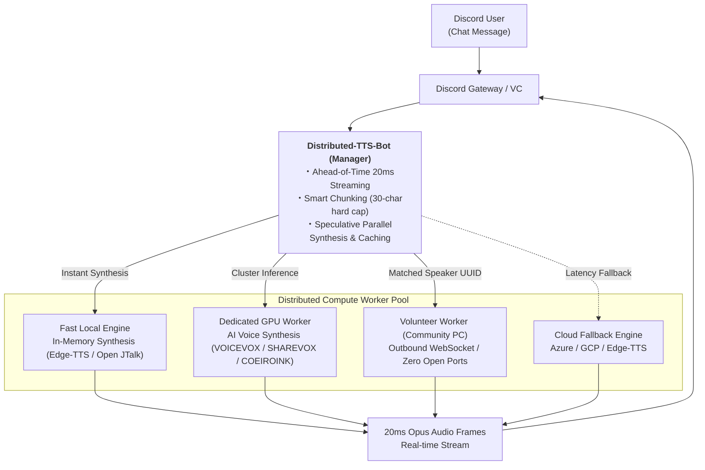

# Distributed-TTS-Bot

<div align="center">


**Next-Generation Distributed Compute & Ultra-Low-Latency Streaming TTS Bot for Discord**

[English Documentation](README.en.md) | [日本語ドキュメント (Japanese)](README.md)

</div>

---

## 📖 Overview

**Distributed-TTS-Bot** is an ultra-low-latency Japanese text-to-speech (TTS) Discord bot engineered for real-time natural voice playback in voice channels.

Designed to scale effortlessly from personal friend servers to massive community guilds, it features **distributed compute clustering**, **NAT-traversing volunteer worker nodes**, **dynamic bot slot scaling** for concurrent voice channels, and **high-availability (HA) master/slave failover** with split-brain protection.



---

## ✨ Key Features

### 1. ⚡ Ultra-Low-Latency & Speculative Streaming
- **Smart Chunking with 30-Character Hard Cap**: Intelligently identifies conversational pauses, slang (`w`, `草`), punctuation, and sentence particles. Even long continuous text is sliced into manageable micro-chunks for early speculative synthesis.
- **20ms Frame Streaming**: Starts playing audio in the Discord voice channel the millisecond the first 20ms Opus frame arrives, completely eliminating initial playback buffering lag.

### 2. 🖥️ Distributed Compute & Volunteer Workers
- **NAT-Traversing Outbound WebSocket (WSS)**: Community members can contribute their gaming PCs or inference servers without opening router ports or exposing static IPs.
- **Smart Model Pinpoint Routing**: Automatically detects which speech models (e.g., specific COEIROINK characters or MYCOEIROINK UUIDs) each node owns, routing inference tasks exclusively to nodes that have the requested model ready.
- **Game-Friendly Low Resource Mode**: Features low process priority on Windows, automatic idle container sleep (releasing VRAM/RAM to the OS), and on-demand container waking.

### 3. 🎯 4-Tier Dynamic Routing & Per-Engine Customization
Automatically profiles connected worker hardware specs (GPU presence, RAMDisk resident models, storage bandwidth) and dispatches inference requests with minimal latency:
- **Tier 1: GPU + RAMDisk (Ultra-Fast / Default Top Priority)**: Zero disk I/O latency combined with dedicated GPU compute speed.
- **Tier 2: CPU + RAMDisk (High-Speed / GPU Conservation)**: RAMDisk-resident model inference on CPU, freeing up GPU compute for heavy workloads while providing instant response.
- **Tier 3: GPU + SSD (Medium-Speed / Large Models)**: Neural AI inference accelerated by GPU power with models stored on fast SSD.
- **Tier 4: CPU + SSD (Universal Fallback)**: General-purpose fallback inference across cluster nodes.
- **🎛️ Real-Time Dynamic Reordering in WebUI**: Administrators can reorder tiers using ▲/▼ buttons for each individual synthesis engine (COEIROINK, VOICEVOX, SHAREVOX, etc.) under the "Bot & Node Management" tab.


### 4. ☁️ Multi-Engine Cloud Fallback (Edge-TTS First)
- **Zero Configuration Required**: Works right out of the box using high-quality **Edge-TTS** and **Open JTalk** without needing proprietary GPU hardware or paid API keys.
- **Seamless Cloud Scalability**: Optional integration with Azure Cognitive Services Speech and Google Cloud Text-to-Speech.
- **Instant Fallback**: If a local GPU worker stalls or hits a network timeout, the request speculatively falls back to cloud TTS in parallel, ensuring conversations never stall.

### 5. 🛡️ High-Availability (HA) & Redundancy
- **Master/Slave Auto-Promotion**: Standby nodes monitor master health continuously and promote themselves automatically upon failure.
- **Split-Brain Mitigation**: Isolated master instances autonomously step down (`HTTP 410 Gone`) upon detecting a new active primary.

### 6. 🎛️ Comprehensive Web Management Dashboard
- Built-in responsive WebUI for guild settings, custom user dictionaries, live metrics, multi-bot pool scaling (Bots #1–#10), and one-click copyable worker setup commands.

### 7. 🚫 Robust NG Words & Streamer Incident Prevention (Moderation)
- **Real-Time Masking**: Instantly masks abusive, offensive, or sensitive terms into `＊＊＊` within milliseconds before synthesis.
- **Longest-Match Algorithm & Zero Overhead**: Scans terms ordered by length to prevent partial-match false positives. Fast in-memory caching ensures zero latency impact on speech.
- **Default Spam/Troll Preset**: Import standard moderation wordlists with a single click or command.
- **Dual Support (Slash Commands & WebUI)**: Full management available via Discord chat (`/ng add`, `/ng remove`, `/ng list`, `/ng import_default`) and the web GUI dashboard.

---

## 🚀 Quick Start

### Prerequisites
- **Docker & Docker Compose** (Linux, macOS, or Windows WSL2 / Docker Desktop)
- **Discord Bot Token** (obtainable from the [Discord Developer Portal](https://discord.com/developers/applications))

### Installation Steps

```bash
# 1. Clone the repository
git clone https://github.com/Maximilian2022/Distributed-TTS-Bot.git
cd Distributed-TTS-Bot

# 2. Copy the environment configuration template
cp .env.example .env

# 3. Edit .env (configure your Discord Bot Token and WebUI admin password)
nano .env

# 4. Build and start the containers
docker compose up -d --build
```

Once started, open your web browser and navigate to `http://localhost:8080` (or your server's IP address) to access the management dashboard.

---

## 💬 Essential Discord Slash Commands

| Command | Description |
| :--- | :--- |
| `/join` | Summons the bot to your current voice channel |
| `/leave` | Disconnects the bot from the voice channel |
| `/voice` | Opens the interactive menu to select speakers, adjust speed, and tune pitch |
| `/dict add <word> <reading>` | Registers a word in the guild-wide reading dictionary |
| `/dict delete <word>` | Removes a word from the dictionary |
| `/userdict` | Configures personal reading dictionary entries |
| `/ng add <word>` | Registers an NG word (automatically masked with `＊＊＊`) |
| `/ng remove <word>` | Removes a word from the NG word list |
| `/ng list` | Displays the server's registered NG words |
| `/ng import_default` | Imports the default recommended troll/abuse protection preset |
| `/help` | Displays a detailed list of commands and troubleshooting tips |

---

## 🔄 Safe Zero-Downtime Update Guide

To keep Discord voice channels connected without interruption, an automated safe update script is included with **pre-downloading** and **HA failover guard**.

### Recommended: One-Liner or Script Execution (~2s Downtime)

```bash
# Run local script in repo (fastest & recommended)
./update.sh

# Or run via web one-liner
curl -sSL "https://<YOUR_DOMAIN>/update.sh" | sudo bash
```

### Safety Features
- ⚡ **Pre-Pulling (~2s Downtime)**: Pulls the latest Docker Hub image in the background *before* touching the running container, reducing switchover pause to ~2 seconds.
- 🛡️ **HA Split-Brain Guard**: Emits a maintenance signal (`data/.ha_updating`) so standby slave nodes gracefully delay failover decisions during master upgrades.
- 🤖 **Volunteer Worker Auto-Update**: Once master boots the new version, it automatically broadcasts an update signal to all connected volunteer workers via WebSocket, triggering immediate restart to latest code.
- 💾 **Automatic Database Backup**: Backs up SQLite databases and config files (`data/*.db`, `data/*.json`) into `data_backup/` before proceeding.

#### Command-Line Options:
```bash
./update.sh --build       # Build locally from Dockerfile instead of Docker Hub
./update.sh --clean       # Prune obsolete dangling images after update
./update.sh --no-cache    # Completely discard build cache (use with --build)
```

---

## 🖥️ Connecting Worker Nodes

From the WebUI **"Bot & Node Management"** tab, you can easily copy one-liner scripts to expand your compute cluster:

### 1. Dedicated Inference Server Worker (Docker)
```powershell
# Windows (Docker Desktop / Administrator PowerShell)
irm "https://<YOUR_DOMAIN>/setup-worker.ps1" | iex
```
```bash
# Linux (Debian / Ubuntu / Docker)
curl -sSL "https://<YOUR_DOMAIN>/setup-worker.sh" | sudo bash
```

### 2. Volunteer Worker (Gaming PC / No Port Forwarding Required)
```powershell
# Windows Native GUI Launcher
$env:TTSBOT_SERVER_URL="wss://<YOUR_DOMAIN>/api/worker/ws"; $env:TTSBOT_WORKER_TOKEN="<YOUR_TOKEN>"; irm "https://<YOUR_DOMAIN>/volunteer/run_volunteer_gui.ps1" | iex
```

---

## 📜 License & Disclaimers

Distributed-TTS-Bot is open-source software licensed under the **[Apache License, Version 2.0](LICENSE)**.

For third-party software attributions, embedded voice models (MMDAgent Mei/Takumi), and voice engine (VOICEVOX, COEIROINK, SHAREVOX) character usage guidelines and disclaimers, please refer to **[NOTICE.md](NOTICE.md)**.

- [Code of Conduct](CODE_OF_CONDUCT.en.md) ([日本語](CODE_OF_CONDUCT.md))
- [Contributing Guide](CONTRIBUTING.en.md) ([日本語](CONTRIBUTING.md))
- [Security Policy](SECURITY.en.md) ([日本語](SECURITY.md))
