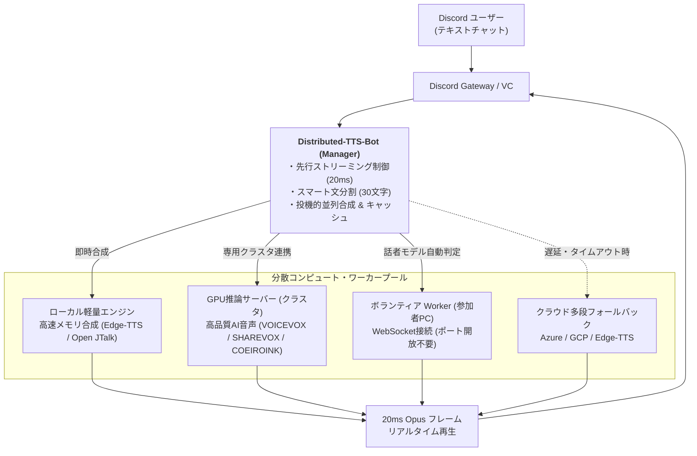

# Distributed-TTS-Bot

<div align="center">


**分散コンピュート・超低遅延ストリーミング対応の次世代 Discord 音声合成（TTS）Bot**

[日本語ドキュメント](README.md) | [English Documentation](README.en.md)

</div>

---

## 📖 概要

**Distributed-TTS-Bot** は、自然な日本語音声でテキストチャットを高速読み上げする、Discord 専用の超低遅延音声合成 Bot です。

単一サーバーでの個人利用はもちろん、複数台の PC や GPU マシンを束ねる**分散コンピュート・クラスタリング**、参加者のゲーミング PC を活用する**ボランティア Worker**、複数ボイスチャンネルを同時にカバーする**動的 Bot スロット**、さらに Master/Slave の**無停止 HA 冗長化機構**を備えています。



---

## ✨ 主な機能

### 1. ⚡ 超低遅延・先行ストリーミング再生
- **多段チャンキング & 30文字ハードキャップ**: 口語文、スペース区切り、ネットスラング（`w`, `草`）、終助詞境界をミリ秒単位で賢く識別。句読点のない長文チャットでも 30 文字以内で安全にスライスして先行並列合成。
- **20ms フレーム直接送出**: 合成完了を待たずに生成された最初の音声チャンクから即座に Discord VC へストリーミング再生を開始し、発言から再生開始までの待機時間を極限まで削減。

### 2. 🖥️ 分散コンピュート & ボランティア Worker
- **ポート開放不要のアウトバウンド接続**: 一般メンバーの Windows/Linux PC から、WebSocket（WSS）経由で手軽にコンピュートノードとしてクラスタに参加可能。
- **スマート・モデルルーティング**: ボランティア機が保有しているモデル（COEIROINK の MYCOEIROINK や公式話者）を自動検知し、該当モデルのリクエストのみをピンポイントで振り分け。
- **ゲーム連動低負荷モード**: ゲーミング PC の邪魔にならない低プロセスピリオティ設定、無通信時の自動コンテナ停止（メモリ返却）に対応。

### 3. 🎯 4段階 動的 Tier ルーティング（エンジン毎の優先順位制御）
接続されているワーカーのハードウェア性能（GPU の有無、RAMDisk 常駐モデル、ストレージ速度）を自動プロファイルし、最もレイテンシの低い最適なノードへタスクを動的割り当て：
- **Tier 1: GPU + RAMDisk (最速・即時応答)**: GPU 高速推論 & メモリ常駐によるディスク I/O ゼロの超低遅延合成（デフォルト最優先）。
- **Tier 2: CPU + RAMDisk (高速・GPU温存)**: メモリ常駐モデルによる高速推論。GPU 負荷を温存しつつ瞬時に応答。
- **Tier 3: GPU + SSD (中速・大容量モデル)**: GPU パワーをフル活用した高品質 AI 音声合成。
- **Tier 4: CPU + SSD (汎用・安定フォールバック)**: 最下位フォールバック用。
- **🎛️ WebUI 動的並び替え**: 「Bot & ノード管理」画面から、エンジン毎（COEIROINK, VOICEVOX, SHAREVOX 等）に ▲/▼ ボタンで優先順位をリアルタイムにカスタマイズ可能。


### 4. ☁️ 多段クラウドフェイルオーバー（Edge-TTS ファースト）
- **初期設定不要**: 高価な GPU や API キーがなくても、無料の **Edge-TTS** または **Open JTalk** ですぐに高品質な音声合成が動作。
- **自動フォールバック**: ローカルエンジンや Worker に高負荷・障害が発生した場合、瞬時にクラウド API（Edge-TTS / Azure / GCP）へフォールバックし、通話を一切途切れさせません。

### 5. 🛡️ 完全無停止 HA（高可用性）冗長化
- **Master/Slave 自動昇格**: 主系（Master）の死活を常時監視。障害検知時に副系（Slave）が自動昇格して通話を継続。
- **Split-Brain 防護**: 分断された旧 Master からの自律降格（HTTP 410 Gone 自律停止）により多重稼働事故を完全防止。

### 6. 🎛️ 直感的な WebUI 管理ダッシュボード
- ブラウザからギルドごとの読み上げ設定、ユーザー個別辞書、Bot 稼働スロット（1〜10号機）、分散 Worker の稼働状態を一元管理。
- クラスタ追加用のワンライナー（PowerShell / Bash）を画面からワンクリックでコピー可能。

---

## 🚀 クイックスタート

### 1. 必要要件
- **Docker / Docker Compose**（Linux / macOS / Windows Docker Desktop）
- **Discord Bot Token**（[Discord Developer Portal](https://discord.com/developers/applications) から取得）

### 2. インストール手順

```bash
# 1. リポジトリのクローン
git clone https://github.com/Maximilian2022/Distributed-TTS-Bot.git
cd Distributed-TTS-Bot

# 2. 環境設定ファイルの準備
cp .env.example .env

# 3. .env の編集 (Bot Token や管理者パスワードを設定)
nano .env

# 4. コンテナのビルドと起動
docker compose up -d --build
```

起動後、ブラウザで `http://localhost:8080`（またはサーバーのホスト名・IP）にアクセスすると管理ダッシュボードが開きます。

---

## 💬 主な Discord スラッシュコマンド

| コマンド | 説明 |
| :--- | :--- |
| `/join` | コマンドを実行したボイスチャンネルに Bot を呼び出します |
| `/leave` | Bot をボイスチャンネルから退出させます |
| `/voice` | 声色（話者）・読み上げ速度・ピッチ（音高）の変更メニューを表示します |
| `/dict add <単語> <読み>` | サーバー共通の単語辞書に新しい読みを登録します |
| `/dict delete <単語>` | 登録済みの単語を辞書から削除します |
| `/userdict` | ユーザー個人の専用単語辞書を設定します |
| `/help` | コマンド一覧と詳しい使い方を表示します |

---

## 🖥️ Worker ノードの追加方法

WebUI ダッシュボードの「Bot & ノード管理」タブから、専用のワンライナーを取得して簡単に Worker を追加できます：

### 1. 常時稼働クラスタ用 Worker (Docker)
```powershell
# Windows (Docker Desktop / 管理者 PowerShell)
irm "https://<YOUR_DOMAIN>/setup-worker.ps1" | iex
```
```bash
# Linux (Debian / Ubuntu / Docker)
curl -sSL "https://<YOUR_DOMAIN>/setup-worker.sh" | sudo bash
```

### 2. ボランティア Worker (個人 PC / ポート開放不要)
```powershell
# Windows ネイティブ GUI ランチャー
$env:TTSBOT_SERVER_URL="wss://<YOUR_DOMAIN>/api/worker/ws"; $env:TTSBOT_WORKER_TOKEN="<YOUR_TOKEN>"; irm "https://<YOUR_DOMAIN>/volunteer/run_volunteer_gui.ps1" | iex
```

---

## 📜 ライセンス & 免責事項

本ソフトウェアは **[Apache License, Version 2.0](LICENSE)** のもとで公開されています。

サードパーティ製ライブラリの帰属表示、同梱モデル（MMDAgent Mei/Takumi）、および音声合成エンジン（VOICEVOX, COEIROINK, SHAREVOX）のキャラクター利用ガイドラインに関する免責事項については、**[NOTICE.md](NOTICE.md)** をご確認ください。

- [行動規範 (Code of Conduct)](CODE_OF_CONDUCT.md) ([English](CODE_OF_CONDUCT.en.md))
- [コントリビューションガイド (Contributing Guide)](CONTRIBUTING.md) ([English](CONTRIBUTING.en.md))
- [セキュリティポリシー (Security Policy)](SECURITY.md) ([English](SECURITY.en.md))
