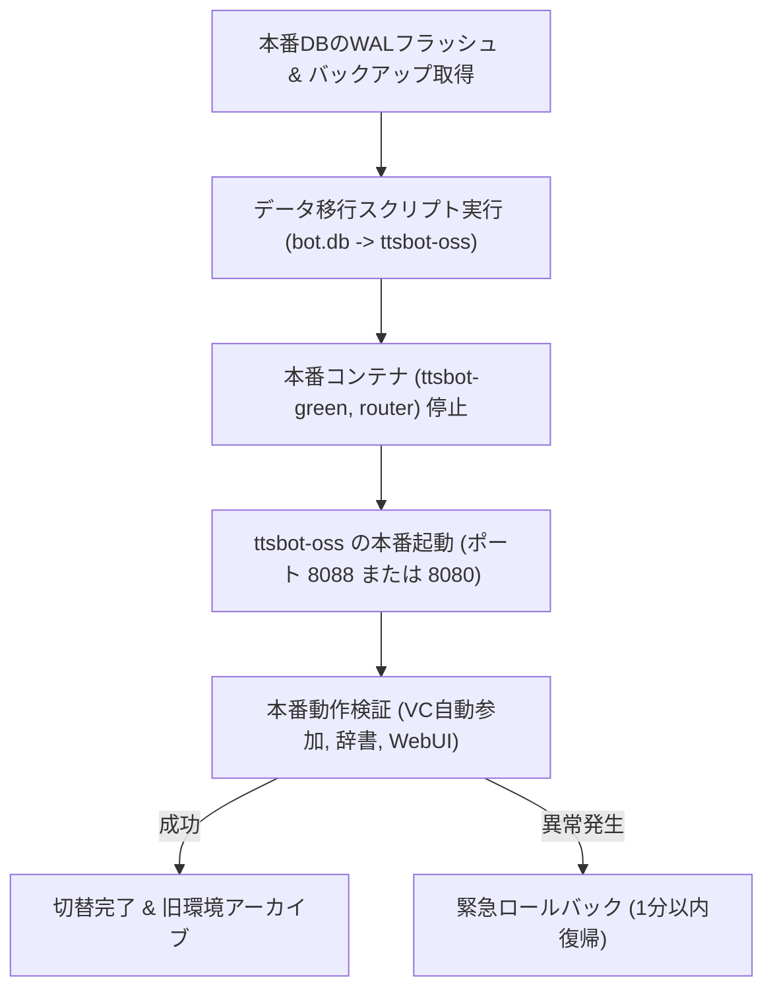

# ttsbot-oss 残存タスクおよび移行手順計画書 (remaining.md)

本書は、後日作業を再開した際に迷いなく安全に移行を完遂できるよう、これまでに完了した全実装・検証内容と、残存する移行ステップ（本番データ引き継ぎ、Side-by-Side切替、緊急ロールバック手順、検証チェックリスト）を網羅した詳細引き継ぎドキュメントです。

---

## 1. プロジェクト現況と完了実績

### 1.1 基本方針
- **Side-by-Side 移行戦略**: 稼働中の本番環境（`/root/ttsbot`、`ttsbot-green`）には一切干渉せず、独立環境（`/root/ttsbot/ttsbot-oss`）で新機能を実装・検証完了済み。
- **データ無欠損**: 既存の単語辞書、ギルド設定（自動参加VCペア、防災速報設定等）、ユーザー個別音声設定を100%引き継ぐ。

### 1.2 完了済みタスク一覧 (Tasks 1〜8 全完了)

- [x] **基盤初期化 & ドキュメント策定**:
  - 機密情報・過去Git履歴を除外し、独立クリーンリポジトリ（ブランチ `main`）を初期化。
  - 一般向け [README.md](file:///root/ttsbot/ttsbot-oss/README.md) および詳細動作仕様書 [MANUAL.md](file:///root/ttsbot/ttsbot-oss/MANUAL.md) を作成。
- [x] **Task 1: `src/main.py` ブートストラップ改修**:
  - トークン0件時でもプロセスを終了せず、WebUIを先行起動して待機するブートストラップを実装。
  - `TTSBot` から `WebServer` のライフサイクルを完全分離し、`main()` 直下で独立稼働。
  - `bot_factory` 注入設計、起動時DBトークン自動適用、常駐シャットダウン待機を実装。
- [x] **Task 2: `src/bot_pool.py` 動的Botライフサイクル**:
  - `start_bot(idx, token)`、`stop_bot(idx)`、`add_or_update_token(...)`、`delete_token(idx)`、`toggle_token(idx, enabled)` を実装。
  - 全10スロットの稼働・DB状態を集約する `get_full_pool_status()` を実装。
- [x] **Task 3: `src/tts/manager.py` Edge-TTS ファースト化 & 動的リロード**:
  - Azure/Google未設定時でもEdge-TTS / OpenJTalk で即座に動作。
  - `reload_cloud_credentials(...)` によるAPIキーの無停止ホットリロードを実装。
  - `test_synthesis(provider, voice_name)` による即時疎通・レイテンシ計測テスト合成を実装。
- [x] **Task 4: `src/web/server.py` バックエンドAPI & WebSocketリバースプロキシ**:
  - `POST /api/auth/login_password`: `.env` の `ADMIN_PASSWORD` による管理者セッション発行。
  - `GET|POST|DELETE /api/system/bots` および `toggle`: 1〜10号機トークンの動的プール管理。
  - `GET|POST /api/system/credentials` および `test`: APIキー管理と即時音声合成テスト。
  - `GET /api/worker/ws`: リモートWorker用 WebSocket リバースプロキシ。
  - `/health`: トークン0件待機状態を `200 OK` (`status: "waiting_setup"`) として判定。
- [x] **Task 5: Worker Agent & setup-worker.sh の WebSocket NAT越え対応**:
  - `src/web/static/agent.py`: `--master-ws` 引数および `MASTER_WS_URL` による常時双方向接続、ローカルエンジン（VOICEVOX / COEIROINK / SHAREVOX）合成連携を実装。
  - `src/web/static/setup-worker.sh`: CLI引数（`--master-ws`, `--secret`）パース対応。
- [x] **Task 6: WebUI フロントエンド (`index.html`, `app.js`)**:
  - 未ログイン画面に「管理者パスワードでログイン」フォームを追加。
  - 「🤖 Discord Bot 管理」画面（1〜10号機スロットカード、招待URL生成、モーダル設定）を追加。
  - 「🔑 API・クレデンシャル設定」画面（Azure/Googleキー、Worker秘密鍵再生成、ワンライナー表示）を追加。
- [x] **Task 7: Docker Compose プロファイル化 & .env.example 最新化**:
  - デフォルトでスタンドアロン (`app`)、オプションで `--profile voicevox`, `--profile tunnel` を導入。
  - ボリューム名をプロジェクト固有（プリフィックス付き）とし、現本番環境との競合を完全排除。
  - `.env.example` を初心者向けに整理・最新化。
- [x] **Task 8: 実機サンドボックス検証 (ポート 8095)**:
  - 一時コンテナ `ttsbot-test-app-1` を起動し、以下の全項目を完全検証・合格：
    - `/health` 応答: `200 OK` (`status: "waiting_setup"`)
    - 管理者パスワード認証: 誤パスワード `401` / 正パスワード `200` + Cookie発行
    - Botプール管理: 全10スロット取得、登録、下4桁以外伏字化、トグル、削除
    - クレデンシャル管理: APIキー設定更新、ホットリロード
    - **Edge-TTS 音声合成: 787.7ms で完全成功 (156,750 bytes)**
    - **OpenJTalk 音声合成: 152.6ms で完全成功 (237,644 bytes)**
  - 検証完了後、テストコンテナ・ボリューム・一時ファイルを完全処分。
  - 現本番コンテナ（`ttsbot-green`, `ttsbot-router`, `ttsbot-tunnel`）の無影響・正常稼働を継続確認。
- [x] **Git コミット完了**: コミット `7ae2d7c` を作成済み。

---

## 2. 残存作業計画（次回再開時の手順書）

次回作業時は、以下の **Step 3 (データ移行と切替)** を順に実行します。
所要時間は約10〜15分、サービス停止時間（ダウンタイム）は約30秒〜1分を想定しています。



---

### Task 9-1: 本番DBバックアップ & データ移行スクリプトの実行

#### 目的
稼働中の本番DB（`/root/ttsbot/data/bot.db`）からデータを抽出し、新環境のスキーマ（`system_credentials` や `bot_tokens` を含む）へ安全に流し込みます。

#### 手順
1. **本番DBのWALフラッシュとバックアップコピー**:
   本番プロセスを止めずに、SQLiteのWALログを確実に本体DBへマージして安全なコピーを作成します。
   ```bash
   sqlite3 /root/ttsbot/data/bot.db "PRAGMA wal_checkpoint(TRUNCATE);"
   mkdir -p /root/ttsbot/ttsbot-oss/data
   cp /root/ttsbot/data/bot.db /root/ttsbot/ttsbot-oss/data/bot.db.bak_$(date +%Y%m%d_%H%M%S)
   cp /root/ttsbot/data/bot.db /root/ttsbot/ttsbot-oss/data/bot.db
   ```

2. **移行スクリプト（`scripts/migrate_from_prod.py`）の作成と実行**:
   本番の `.env` から既存設定（Botトークン1〜5号機、Azure/Googleキー、管理者パスワード）を読み込み、新DBの `system_credentials` および `bot_tokens` テーブルへ自動格納します。
   - 保持テーブル: `dictionary`, `user_settings`, `guild_settings`, `character_terms`（全件そのまま保持）
   - 新規テーブル作成: `system_credentials`, `bot_tokens`

   ```bash
   python3 -c "
   import sqlite3, os

   db_path = '/root/ttsbot/ttsbot-oss/data/bot.db'
   conn = sqlite3.connect(db_path)
   cur = conn.cursor()

   # テーブル作成 (未作成の場合)
   cur.execute('''
   CREATE TABLE IF NOT EXISTS system_credentials (
       key TEXT PRIMARY KEY,
       value TEXT NOT NULL,
       updated_at REAL NOT NULL
   )
   ''')
   cur.execute('''
   CREATE TABLE IF NOT EXISTS bot_tokens (
       bot_index INTEGER PRIMARY KEY,
       token TEXT NOT NULL,
       label TEXT DEFAULT '',
       is_enabled INTEGER DEFAULT 1,
       updated_at REAL NOT NULL
   )
   ''')

   # 本番 .env の読み込み
   env_vars = {}
   with open('/root/ttsbot/.env', 'r', encoding='utf-8') as f:
       for line in f:
           line = line.strip()
           if line and not line.startswith('#') and '=' in line:
               k, v = line.split('=', 1)
               env_vars[k.strip()] = v.strip().strip('\"\'')

   # 1〜5号機トークンを bot_tokens に格納
   tokens = [
       (1, env_vars.get('DISCORD_TOKEN', ''), 'メイン代表Bot (1号機)'),
       (2, env_vars.get('DISCORD_TOKEN_2', ''), '多重化ワーカー (2号機)'),
       (3, env_vars.get('DISCORD_TOKEN_3', ''), '多重化ワーカー (3号機)'),
       (4, env_vars.get('DISCORD_TOKEN_4', ''), '多重化ワーカー (4号機)'),
       (5, env_vars.get('DISCORD_TOKEN_5', ''), '多重化ワーカー (5号機)')
   ]
   import time
   now = time.time()
   for idx, tok, lbl in tokens:
       if tok:
           cur.execute('INSERT OR REPLACE INTO bot_tokens (bot_index, token, label, is_enabled, updated_at) VALUES (?, ?, ?, 1, ?)', (idx, tok, lbl, now))

   # クレデンシャルを system_credentials に格納
   creds = {
       'azure_speech_key': env_vars.get('AZURE_SPEECH_KEY', ''),
       'azure_speech_region': env_vars.get('AZURE_SPEECH_REGION', 'japaneast'),
       'google_api_key': env_vars.get('GOOGLE_API_KEY', ''),
       'worker_shared_secret': env_vars.get('WORKER_SHARED_SECRET', ''),
       'web_base_url': 'https://ttsbot.kenko.land'
   }
   for k, v in creds.items():
       if v:
           cur.execute('INSERT OR REPLACE INTO system_credentials (key, value, updated_at) VALUES (?, ?, ?)', (k, v, now))

   conn.commit()
   conn.close()
   print('✅ Data migration completed successfully.')
   "
   ```

3. **移行後DBの整合性確認**:
   ```bash
   sqlite3 /root/ttsbot/ttsbot-oss/data/bot.db "SELECT count(*) FROM dictionary;"
   sqlite3 /root/ttsbot/ttsbot-oss/data/bot.db "SELECT count(*) FROM user_settings;"
   sqlite3 /root/ttsbot/ttsbot-oss/data/bot.db "SELECT bot_index, label, is_enabled FROM bot_tokens;"
   ```

---

### Task 9-2: 本番 Side-by-Side 切替実行

#### 目的
本番ポート（`8088` または `8080`）および Cloudflare Tunnel を `ttsbot-oss` 側へ切り替えます。

#### 切替手順
1. **本番用 `.env` の準備 (`ttsbot-oss/.env`)**:
   本番環境の `CLOUDFLARE_TUNNEL_TOKEN`、`DISCORD_CLIENT_ID`、`DISCORD_CLIENT_SECRET` 等を `ttsbot-oss/.env` に記述します。
   ```bash
   cat << 'EOF' > /root/ttsbot/ttsbot-oss/.env
   ADMIN_PASSWORD=your_secure_admin_password
   WEB_BASE_URL=https://ttsbot.kenko.land
   WEB_PORT=8088

   # 本番 Cloudflare Tunnel トークン (本番 .env より引き継ぎ)
   CLOUDFLARE_TUNNEL_TOKEN=eyJh...

   # Discord OAuth2 ログイン設定 (本番 .env より引き継ぎ)
   DISCORD_CLIENT_ID=1418859344445673554
   DISCORD_CLIENT_SECRET=...
   DISCORD_REDIRECT_URI=https://ttsbot.kenko.land/callback
   EOF
   ```

2. **切替実行（旧コンテナ停止 ➔ 新コンテナ起動）**:
   ※ここからの所要時間は約30秒です。
   ```bash
   # 1. 旧本番コンテナの停止
   cd /root/ttsbot
   docker compose stop ttsbot-green ttsbot-router ttsbot-tunnel

   # 2. 新環境 (ttsbot-oss) の本番起動 (Tunnel付き)
   cd /root/ttsbot/ttsbot-oss
   docker compose --profile tunnel up -d
   ```

---

### Task 9-3: 緊急ロールバック手順（トラブル時・1分以内復帰）

万が一、切替後に予期せぬ不具合が発生した場合、以下のコマンドを実行することで**1分以内に元の本番環境へ完全復旧**できます。

```bash
# 1. 新環境コンテナを即時停止
cd /root/ttsbot/ttsbot-oss
docker compose --profile tunnel down

# 2. 旧本番環境を再開
cd /root/ttsbot
docker compose start ttsbot-green ttsbot-router ttsbot-tunnel

# 3. 復帰確認
docker ps --filter "name=ttsbot"
curl -s http://127.0.0.1:8088/health
```

---

### Task 9-4: 切替後動作確認チェックリスト

新環境起動後、以下の項目を順に確認します。

- [ ] **コンテナステータス確認**:
  - `docker compose ps` で `app` および `tunnel` が `Up (healthy)` であること。
- [ ] **ヘルスチェック確認**:
  - `curl -s http://127.0.0.1:8088/health` で `status: "ok"`、`bot.is_ready: true`、`bot.latency_ms` が返ること。
- [ ] **WebUI 接続確認**:
  - ブラウザで `https://ttsbot.kenko.land` を開き、ログイン画面が表示されること。
  - 管理者パスワードまたはDiscordアカウントでログインできること。
- [ ] **Bot 動作確認**:
  - 1号機（柴ヴォ）がVCへ自動復帰、または `/join` で通話参加すること。
  - チャット送信時に Edge-TTS / Azure で遅延なく読み上げられること。
  - 既存の単語辞書や個人声質が正しく反映されていること。
- [ ] **多重化ワーカーBot確認**:
  - 別VCで `/join` を実行した際、2号機以降の空きスロットBotが自動アサインされて入室すること。
- [ ] **リモートWorker疎通確認**:
  - 自宅GPUマシン（Worker）から Master（`/api/worker/ws`）へ外向きWebSocket接続が維持されていること。

---

### Task 10: GitHub 公開前最終チェック & 不要ファイル監査

本番運用移行が安定した後、GitHub等でOSS公開するための最終監査を行います。

- [ ] **機密情報スキャン**:
  - リポジトリ全域に対して `gitleaks` または `grep` を実行し、APIキー、トークン、パスワード、秘密鍵の混入がゼロであることを確認。
  - `git log -p` で過去コミットも含めて機密情報がないことを再検証。
- [ ] **`.gitignore` の再検証**:
  - `.env`, `data/*.db`, `logs/*`, `cache/*` が除外されていることを確認。
- [ ] **オープンソースライセンスの明記**:
  - `LICENSE` ファイル（MIT License等）の配置。
- [ ] **一時ファイルの完全清掃**:
  - `scratch/` 内の一時作業スクリプトやバックアップファイルの削除。
